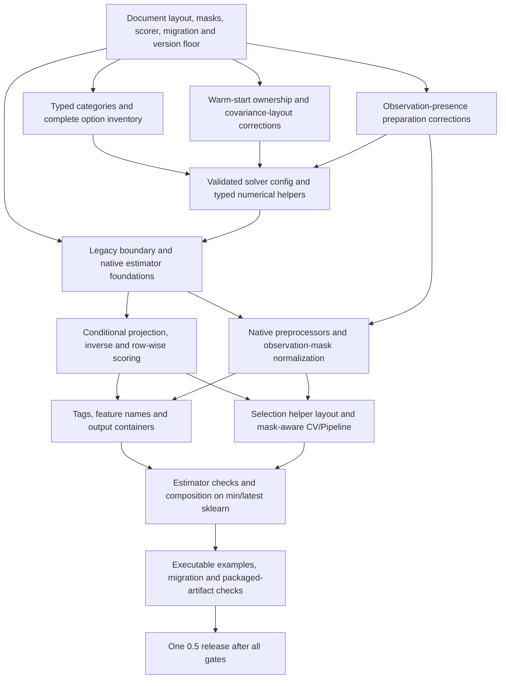

# VBPCApy 0.5 implementation and dependency plan

Approved by the maintainer on 21 October 2026. All changes below are bundled
into one 0.5 release after the gates pass. This supersedes the proposed 0.4.13
follow-up. The current public release remains 0.4.12 during development.

This work covers Python modernization and the estimator stack. Manuscript
editing and frozen study installations are separate work. Existing numerical
policies and archived results are not migrated by changing the public API.

## Contract decisions made before implementation

| Boundary | 0.5 contract |
|---|---|
| Python | Keep Python 3.11 as the minimum; test 3.11–3.14 |
| scikit-learn | Native runtime dependency, minimum 1.8; test minimum and current stable (1.9.1 at this checkpoint). The mask/scoring dependency probe below determines the floor |
| Public estimators and selection helpers | Samples × features, including masks, probe tables and held-out data. Never infer orientation from dimensions |
| Low-level numerical solver | `pca_full` retains features × samples, historical result keys and its independent numerical-reference contract |
| Migration | An explicit `vbpca_py.legacy` adapter preserves the 0.4 layout/API for callers that need it. It is documented as a compatibility API, not advertised as a native Pipeline estimator |
| Loading/score attributes | Modern `components_` is `(q, p)`; `scores_` is the joint training variational mean `(n, q)`; `mean_` is `(p,)` |
| Projection | `transform(X_new)` conditions on the fitted loading/mean/noise state and does not update that state. It returns `(n_new, q)` |
| Fit-transform | Return `fit(X).transform(X)` for native Pipeline consistency. Training variational scores remain available separately in `scores_`; do not assert that they equal conditional projections |
| Inverse | `inverse_transform(Z)` returns `(n, p)`, including q=0, under the existing dense-output budget |
| Rank zero | Preserve q=0 as a mean-only model. Negative/nonintegral ranks and ranks above declared dimensions fail clearly. The older issue requiring q=0 rejection is superseded |
| Constructors | Explicit keyword parameters, stored unchanged. No learned attributes, coercion or fit-time validation in `__init__`. Standard `get_params`, `set_params`, clone and nested grid-search parameter discovery |
| Fitted validation | Use `validate_data` and `check_is_fitted`; record `n_features_in_`, check names/order at inference, reset learned state on a new fit |
| Types | Float64 numerical arrays, Boolean masks, signed sparse-index arrays, typed category/configuration values and covariance/projection records. Shape and ownership checks remain runtime contracts |
| New-data uncertainty | A documented `transform_posterior` result exposes means and score covariances; ordinary `transform` returns only means |
| Default row-wise score | Mean plug-in Gaussian marginal log likelihood of observed entries under fitted loading means and noise. Accept optional one-dimensional row `sample_weight` for scoring, separately from entry masks; never reinterpret weights as a training likelihood. Document that this is not the variational objective or exact uncertainty-integrated VB predictive likelihood |
| Cellwise capacity selection | Keep explicit entry/variable-cell CV and PRMS/Brier criteria separate from row-wise `GridSearchCV` scoring. Selection targets and folds are not interchangeable |

Projection is checked against the independent conditional-normal equations.
For an observed feature set O, VB score precision is
`I + sum_O(E[a_j a_j.T]) / V`, and its mean is the precision solve against
`sum_O(a_j * (x_j - mu_j)) / V`. Retain full loading-covariance terms for VB;
PPCA/MAP use their supported point-estimate representation. A wholly missing
new row has zero score mean and prior score covariance. Training on an empty
or entirely unobserved table fails clearly. Individually unobserved training
features raise a clear error at the modern fit boundary; a caller must supply
an explicit feature-selection policy. Preserve observed constant columns and
all-missing sample rows. The legacy adapter retains its documented historical
handling. Do not invent identified loadings for unobserved features.

The plug-in Gaussian score uses the marginal covariance of observed features,
`A_O A_O.T + V I`, with a stable solve/log determinant. Empty observed subsets
have zero log-density contribution; scoring a table with no observations
fails. Test this against an independent Gaussian calculation. This score is a
public estimator convenience, not a new scientific default or calibration claim.
Scoring weights must be finite, nonnegative, have one value per row and a
positive sum. Row scores are averaged with these weights; training remains
unweighted. Explicitly request scoring weights when routing is enabled because
`Pipeline.score` forwards `sample_weight`, including its default `None`.

## Missingness and Pipeline decisions

Dense missingness is represented canonically by NaN between Pipeline steps.
Numeric zero remains observed. An explicit Boolean mask can be supplied to a
direct estimator call, or consumed by a leading, sample-preserving
`ObservationMasker` transformer that turns masked placeholders into NaN before
any learned preprocessing. That transformer implements native metadata
requests and a `fit_transform` that forwards the mask consistently.

A raw entry-wise mask must not be forwarded unchanged across a width-changing
encoder. Do not use `Pipeline(transform_input=["mask"])` to feed a Boolean mask
through arbitrary numeric or categorical transforms. Metadata routing carries
arguments; it does not define how feature-level observation patterns expand.
Supported dense encoders infer NaN masks and propagate missingness to every
column in the corresponding encoded block. Encoding vocabularies, means,
scales and other learned preprocessing are fitted within each training fold.
External codebook levels remain externally declared, not learned from test rows.

For sparse inputs, preserve the package's explicit stored-entry observation
contract: stored zeros are observed, absent entries are missing. Convert sparse
containers without dropping explicit zeros. Package sparse preprocessors and
row slicing must retain this structure, including one-hot expansion. Operations
that eliminate stored zeros change this observation contract and cannot be
advertised as safe without qualification. A sparse constructor built from a
dense array may discard observed zeros; document explicit construction and the
dense/explicit-mask alternative. Do not silently densify a large table.

Native `Pipeline` supports the NaN/structural paths without separate metadata.
Explicit-mask pipelines opt into scikit-learn metadata routing and consume the
mask before preprocessing. Test train and test mask row slicing in
`cross_validate` and `GridSearchCV`, fit-transform forwarding, scoring and
inference. Direct stale-mask shape errors must be informative. Entry masks are
not sample weights. The preimplementation probe found that scikit-learn 1.6.1
and 1.7.2 silently omit the leading transformer's test mask with default
`cross_validate` scoring, although they route the training mask. The same probe
passes in 1.8.0 and 1.9.1, including row slicing and two-column expansion. This
sets the minimum at 1.8, rather than the initially considered 1.6. Keep this
regression in the integration suite; do not rely on a private scorer workaround.
Custom scorers require their own explicit metadata contract and tests; support
for default estimator scoring does not establish arbitrary scorer support.
State which paths have been tested; arbitrary third-party
transformers do not acquire a missingness contract automatically.

The complete [51-option inventory](V05_OPTION_INVENTORY.md) records requested
defaults, accepted categorical values, legacy aliases/fallbacks and the
configuration/data/runtime split before typed configuration is implemented.

## Constructor, typing and ownership particulars

- Inventory every accepted low-level option, alias and value before replacing
  option dictionaries. The public constructor must expose every supported
  tunable parameter; an opaque config argument or `**opts` cannot hide it.
- Use `StrEnum` or `Literal` where appropriate. Existing strings are parsed
  explicitly; enums do not provide automatic coercion or compatibility.
  Parse values at fit/configuration resolution, preserving constructor inputs.
- Build a validated, frozen/slotted `PCAOptions` at the numerical boundary.
  Separate immutable requested settings from mutable runtime decisions and
  live iteration state. Stage the conversion by subsystem; a record wrapping
  an untyped catch-all dictionary does not complete the work.
- Copy mutable constructor values only when resolving a fit. Test that clone,
  repeated fitting, `set_params` and grid search do not share writable state.
  A frozen dataclass does not freeze a NumPy array. Define ownership, write
  flags and serialization for every new record containing arrays.
- Keep dtype-specific arrays distinct from dimensions: dense float64 data,
  Boolean observations, signed sparse indices, categorical object tables and
  list/stacked covariance stores need different annotations and validation.
- Import real scikit-learn bases at runtime and remove the optional/no-op
  shim. Keep third-party typing limitations narrowly scoped; no stand-in
  classes or broad `Any` should conceal the package's own contracts.
- Modernize helper functions at meaningful state boundaries. Retain equation
  order, covariance cross terms, explicit observations and qualified runtime
  choices. Keep mutable training state where the algorithm needs mutation.

## Feature names, containers and scope

All native public preprocessors are included: standard/min-max scaling,
dense/sparse one-hot, ordinal and automatic encoding, log/power transforms and
winsorization. Fit/transform signatures accept y where required and use
keyword-only masks. Constructor values remain inspectable. Sparse one-hot
now supports multiple numeric categorical columns with independent category
blocks, preserving its flat category list and output-to-input group metadata.

Capture string feature names through validation; reject ambiguous duplicate
names and inconsistent names/order at inference. Array inputs use stable
fallback names. Latent outputs use `vbpca0`, `vbpca1`, etc. Expanded encoder names
must agree with the actual column/schema order. Use native output wrapping for
supported dense pandas/polars outputs, preserving row indices. Do not claim a
sparse dataframe-output path that scikit-learn rejects.

`get_feature_names_out`, `__sklearn_tags__`, fitted-state checks and dtype tags
are behavior contracts, not declarations used to hide failing checks. Test
stored sparse zeros, NaNs, feature names, read-only inputs and clone behavior
independently of the generic checks.

## Dependency order

| Work unit | Depends on | Existing tracking and acceptance |
|---|---|---|
| Contract and dependency map | Current source and official API review | This document; #180, #23, #178 |
| Typed categorical options | Contract map and accepted-value inventory | #91; ordinary-string, validation, serialization and native-boundary regressions |
| Structured solver configuration | Typed values and parameter inventory | #92; explicit constructor discovery, no broad option-path Any, compatible low-level calls |
| Helper types and records | Config boundaries and baseline numerical tests | #318; dtype/shape/ownership, bounded refactoring, independent numerical references |
| Native estimators and legacy adapter | Orientation, config and migration decisions | #23/#36/#38; real bases, no var-keyword public constructor, no constructor mutation |
| Projection, inverse and scorer | Fitted model representation and masks | #18; independent algebra, no mutation/refitting, q=0, missing/sparse/new-data cases |
| Preprocessing and Pipeline masks | Native bases, canonical missingness | #178; no leakage, block expansion and CV row slicing; all exported transformers included |
| Tags, names and containers | Actual estimator/preprocessor behavior | #37/#179; focused behavior tests and dense output wrapping |
| Selection helpers | Modern estimator and orientation adapters | Existing CV contracts plus #39; preserve cellwise versus rowwise targets |
| Composition gates | All runtime contracts above | #39; check_estimator, clone, Pipeline, CV, GridSearchCV and caching |
| Examples and migration | Stable public contracts | #14/#19/#25 and #319; source-collected examples and strict docs |
| Release | All required gates and complete Unreleased notes | #180/#314; 0.5 only, proper production workflow and PyPI verification |

The contract document precedes implementation. Each reviewable code change
gets its own PR and merges only after required CI is green. Merge the plan
first, then start typed values/configuration without waiting for unrelated
manuscript work. Code may proceed in independent branches once their documented
dependencies are satisfied; this does not authorize parallel agents.

## Required verification and release gates

1. Independent numerical references remain mandatory. Retain the 0.4.12
   published wheel and pre-migration main revision as comparison baselines;
   preserve the already qualified post-0.4.12 runtime corrections, including
   the screened noise-statistics path. Record intentional public layout/API
   changes separately from unchanged low-level outputs. Do not widen numerical
   tolerances to accommodate refactoring.
2. Run meaningful unit/integration and array-ownership tests per subsystem.
   Test VB/PPCA/MAP, dense/sparse, explicit zeros, masks, rank zero, diagnostics,
   covariance patterns/writeback and native/BLAS thread limits as applicable.
3. All public native estimators pass applicable `check_estimator` checks on
   minimum and current scikit-learn, without ad hoc skips/xfails. Unsupported
   input representations must have honest tags and clear errors. Preserve a
   precise distinction between native estimators and explicit legacy adapters.
4. Test clone, pickle/serialization, nested parameters, Pipeline caching,
   fit-transform, held-out transform/score and grid search. Include original
   masks, one-hot expansion, inferred/declared levels and train/test splits.
5. Run strict source and positive/negative consumer typing, NumPy 2.4 typing
   on supported platforms, Ruff and strict documentation builds. Execute the
   actual docstring/tutorial/example source in bounded CI jobs; optional
   container/plot dependencies get explicit jobs.
6. Compare memory/runtime with representative dense/sparse workloads and
   thread/allocation metadata. Use qualified numerical settings. Performance
   evidence must distinguish layout adapters, solver work and projection, and
   must not choose a new statistical default.
7. The main development version becomes a clearly unreleased 0.5 development
   version before the public breaking migration lands. Release metadata checks
   must distinguish development builds from a published citation/release date.
   Final 0.5.0 metadata, migration notes, classifiers and complete changelog are
   reconciled only when all required work passes.
8. Build/install the source archive and all advertised wheels. Verify public
   types and `py.typed`, imports, real scikit-learn bases and a public-API smoke
   example from installed artifacts. Publish the proper GitHub release to
   trigger PyPI, then verify delivered files and an actual published wheel.

Hardware-tuner reproducibility (#293/#28) and statistical retuning (#214) remain
separately tracked. The migration records resource evidence and preserves
qualified behavior; it does not require inventing a new prior or stopping
policy. FA, factorial posteriors, Zarr and other algorithm additions remain
outside this release's required scope.

## Primary references reviewed

- [Developing scikit-learn estimators](https://scikit-learn.org/stable/developers/develop.html)
- [Metadata routing](https://scikit-learn.org/stable/metadata_routing.html)
- [Pipeline](https://scikit-learn.org/stable/modules/generated/sklearn.pipeline.Pipeline.html)
- [Developing estimators compliant with metadata routing](https://scikit-learn.org/stable/auto_examples/miscellaneous/plot_metadata_routing.html)
- [validate_data](https://scikit-learn.org/stable/modules/generated/sklearn.utils.validation.validate_data.html)
- [TransformerMixin and output wrapping](https://scikit-learn.org/stable/modules/generated/sklearn.base.TransformerMixin.html)
- [check_estimator](https://scikit-learn.org/stable/modules/generated/sklearn.utils.estimator_checks.check_estimator.html)

The installed 1.9.1 source was also inspected for sparse/transformer/small-sample
checks. Versions 1.6.1, 1.7.2, 1.8.0 and 1.9.1 were exercised explicitly rather
than inferring behavior from current documentation. The first implementation PR records the exact dependency/runtime
inventory used for its tests.

## Implementation checkpoint

The contract map merged in #320 before production edits. The categorical
foundation (#324), native empty-eigensystem correction (#323), development
metadata gate (#325), and fit-owned initialization payloads (#329) have merged
after green CI. Main now reports `0.5.0.dev0`; no 0.5 release has been published.
The native estimator layout and conditional projection landed in #337, with
the explicit legacy adapter and migration guide. Typed solver configuration
(#335) and numerical-helper contracts (#336) are also complete. Probe coverage
guards now prevent incomplete diagnostics at native, legacy and low-level
boundaries (#339).

The nine preprocessors keep learned state out of constructors and clear
old/partial state when fitting fails or is interrupted (#340). Native input
validation now checks dimensions, dtypes, feature counts/names, masks and
inverse widths. Sparse one-hot supports multiple independent input columns;
all preprocessors declare their tested sparse/NaN/category input tags. The
default preprocessors pass all applicable generic checks on minimum/current
sklearn without skips or expected failures. Frozen synthetic transforms,
inverse outputs and fitted metadata remain unchanged for existing valid cases.

Strict mixed numeric schema validation, canonical mask routing and generated
names/container wrapping are implemented by #342/#343/#344. Selection now uses
the public samples-by-features boundary and returns native selected models;
the unchanged numerical selection routines remain feature-first internally and
are exposed explicitly through the legacy API. Prepared raw-CV arrays and
numeric predictions use samples-by-encoded-features with versioned serialization.
Combined grouped CV and multi-metric GridSearchCV tests cover mask routing,
scoring-only row weights and dense containers. Custom scorers declare their own
metadata requests; masked inference after search uses the fitted pipeline
through `best_estimator_`, because search `transform` does not accept metadata.
Complete the remaining #14/#19/#25/#319 examples/migration and #314 release
qualification before the single 0.5 release. Frozen scientific registrations
and study outcomes are not migrated by these engineering changes.

The preimplementation/boundary probes identified the prerequisites below,
which have since been addressed before the native estimator migration.
Warm-start ownership (#326, addressed by #329) precedes covariance-layout and
retained-feature metadata corrections (#327). Observation-presence preparation
(#328) precedes typed initialization and native masks/preprocessors. Record
these dependencies in #92/#318/#178 rather than treating them as new scientific
defaults. Covariance axes, sample indices and pattern-block indices need
separate contracts, with full covariance cross terms retained.

Representative runtime tuning (#316) and advisory performance infrastructure
(#321) landed separately during this audit. Include their qualified current-main
behavior in the release assessment; do not repeat completed tuner work or
change frozen study environments. The statistical-policy work remains separate.
